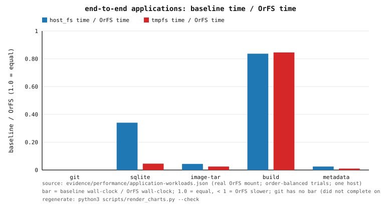

# OrFS — End-to-End Application Workloads (Phase 81)

This document records the **application layer**: five real programs driven end to
end against a **real OrFS FUSE mount** and against external baselines on the same
machine, in the same container.

> **Every number here comes from a real run inside the pinned container and is
> machine-generated into `evidence/performance/application-workloads.json`**
> by `tests/application_workloads.rs` under
> `scripts/container-application-workloads.sh`. The receipt is the authoritative
> record. Where a workload did not complete, that is stated as a loss — no number
> is invented.

The documented position this quantifies: OrFS is **not yet a faster
general-purpose replacement** for ext4/tmpfs on ordinary workloads
(`docs/PERFORMANCE.md` §31.2, Phase 74). This phase measures that at the
**application** layer rather than the filesystem-operation layer.

---

## 1. What is measured, and how

* **Court.** `tests/application_workloads.rs`, run by
  `scripts/container-application-workloads.sh` inside the `Dockerfile.appworkload`
  image (pinned Rust base + `git`, `sqlite3`, `tar`, `gcc`, `make`, `fuse3`).
  A bounded **always-on smoke** runs the same five workloads at a tiny scale; the
  **full sweep** is opt-in (`ORFS_APP_SWEEP=1`) and writes the receipt.
* **The mount.** A real OrFS volume is mounted with `fuse::spawn` — the same code
  path as `orfs mount` — using `MountOptions::default()`: the classical FUSE
  transport (**F0**), synchronous backing I/O, **page cache on**, durability
  `Ordered`. Writes are enabled.
* **Order-balanced trials.** Each workload runs **3 trials**; the arm order
  rotates between trials, and every trial time is recorded alongside the median.
* **Bounded.** Fixed file/op counts (recorded in the receipt and in §2) so every
  workload completes reliably and cannot OOM.

## 2. The workloads (bounded configuration)

The sweep configuration:

* **git repository** — `git init` → `add` → `commit` → modify → `add` → `commit`
  → `git clone --no-local` → `checkout -b` → `gc`, over **1200 files across 60
  directories**.
* **SQLite database** — `PRAGMA journal_mode=WAL`, `synchronous=FULL`, a bulk
  transaction of **20000 rows**, **200** individual fsync'd inserts, an index,
  50 indexed queries, and `VACUUM`, via the `sqlite3` CLI.
* **image-extraction analogue** — extract a **synthetic** OCI-layer-like tarball
  (**2000 small files** of 1 KiB and **4 large files** of 4 MiB, ≈18 MiB) with
  `tar`. It is a synthetic analogue of image extraction, **not** a real
  `docker pull`.
* **source build** — a generated C project with **120 translation units**, built
  with `make -j<8>`.
* **metadata-heavy tree** — **50000 files** (250 directories × 200 files)
  exercised in process with `create`, `stat`, `readdir`, `rename`, `unlink`; each
  of `create`/`stat`/`rename`/`unlink` contributes **50000 samples** and
  `readdir` contributes **250**.

## 3. The baseline contract (why this comparator is fair)

The **primary baseline (`host_fs`)** is a directory on the **same bind-mounted
host filesystem as the OrFS backing volume**. Both arms therefore share the same
storage *device* and differ only in the **filesystem stack** (OrFS-over-FUSE
versus the host's native filesystem, which `stat -f` reports as `ext2/ext3`, i.e.
ext4). That isolates the thing under test instead of conflating it with device
speed — which is the only fair comparison for a filesystem.

A second, clearly-labelled **`tmpfs`** arm (an in-container RAM `tmpfs`) is run as
a **reference floor** only. It is *not* the headline comparator, because RAM
speed is not a filesystem property.

The court also runs a small **semantics probe** on every arm: create a file with
mode `0444` and write through the descriptor the create returned. POSIX checks
the permission at `open`, not per write, so this succeeds on `host_fs` and
`tmpfs`; on OrFS it is refused (see §6). The probe turns the git finding into
evidence rather than an inference.

## 4. Results (one run; release; one host under external load)

`ratio = baseline wall-clock ÷ OrFS wall-clock`; **`< 1` means OrFS is slower**.

| workload | OrFS (s) | host_fs (s) | tmpfs (s) | host_fs/OrFS | tmpfs/OrFS | verdict |
|---|---:|---:|---:|---:|---:|---|
| git repository | **did not complete** | 0.132 | 0.102 | — | — | **loss — refused** (§6) |
| sqlite database | 0.862 | 0.293 | 0.040 | **0.34×** | 0.046× | **loss — 2.9× slower** |
| image-extraction analogue | 0.383 | 0.0168 | 0.0094 | **0.044×** | 0.025× | **loss — 22.7× slower** |
| source build | 0.160 | 0.134 | 0.135 | **0.84×** | 0.85× | **loss — 1.2× slower** |
| metadata tree (50 000 files) | 24.80 | 0.615 | 0.246 | **0.025×** | 0.0099× | **loss — 40.3× slower** |

**Every workload is a loss.** `verdict.orfs_faster_than_baseline = false` for all
five, top-level and machine-readable in the receipt
(`verdict.per_workload`), so the doc cannot drift into an unfounded claim.



*Figure 81.1 — baseline wall-clock divided by OrFS wall-clock per workload
(1.0 = equal, below 1.0 = OrFS slower). git has no bar: it did not complete on
OrFS. Source: `evidence/performance/application-workloads.json`; regenerate with
`python3 scripts/render_charts.py --check`.*

### 4.1 Metadata latency (per operation; p50/p99, µs)

Only the metadata-tree workload is an in-process workload, so it is the only one
that yields per-operation client latency. (readdir is per directory, 200 entries
each.)

| op | OrFS p50 | OrFS p99 | host_fs p50 | host_fs p99 | tmpfs p50 | tmpfs p99 |
|---|---:|---:|---:|---:|---:|---:|
| create | 146.4 | 222.1 | 4.11 | 9.43 | 1.30 | 5.68 |
| stat | 12.73 | 27.54 | 0.44 | 0.63 | 0.30 | 0.44 |
| readdir (per dir) | 364.3 | 469.6 | 24.9 | 50.7 | 12.9 | 34.4 |
| rename | 183.3 | 262.5 | 4.84 | 9.56 | 1.01 | 4.75 |
| unlink | 112.4 | 173.6 | 1.92 | 4.15 | 0.76 | 1.59 |

The **mutating** metadata operations (create/rename/unlink) cost **~36–59×** the
native filesystem; `stat` costs **~29×**; a directory read of 200 entries costs
**~15×** host and **~28×** tmpfs.

## 5. Why (honest reading)

This is the **FUSE round-trip plus metadata cost**, the same mechanism
`docs/PERFORMANCE.md` §20 / §31.2 and `docs/FUSE-SEMANTICS.md` already record:

1. **Every metadata operation is a round trip.** A create is not one syscall but a
   kernel→daemon `CREATE` that the daemon answers with an authoritative,
   append-only commit; a `stat` still costs the request/reply hop unless it hits
   the attribute cache (the mount uses the default 1 s TTLs, so a fresh tree
   misses). ext4 does all of this in the kernel, with the directory and inode
   structures directly reachable.
2. **The whole point of OrFS is durability of history, not metadata speed.**
   Each mutation extends the authoritative log (`L_{n+1} = L_n ⊕ Δ_n`); an
   ordinary filesystem overwrites in place. That is a deliberate, structural
   trade-off, and it is exactly what makes ordinary metadata-heavy applications
   slower.
3. **Bulk `tar` is the worst case** for the same reason: 2004 create+write+close
   sequences, each a full daemon round trip, versus a kernel-resident copy loop.

OrFS's measured advantages remain **internal and structural** (manifested vs
authoritative reads; kernel passthrough vs the daemon; indexed search vs a scan).
None of them is restated here as a win, because the application layer does not
exhibit them.

## 6. Headline finding — OrFS cannot currently host a git repository

The git workload **fails on the OrFS arm** with:

```
fatal: unable to write loose object file: Permission denied
```

**Mechanism (proven, not guessed).** `git` writes a loose object by creating a
file with mode **`0444`** and writing through the descriptor the create returned.
POSIX checks the permission at `open`, so the write succeeds on ext4/tmpfs. OrFS
**re-checks the write bit on every `write`** — documented, intentional semantics
(`docs/FUSE-SEMANTICS.md` §5 and §6: *"`write` | Enforces write permission"*;
*"the checks are applied … at `open`/`read`/`write`"*). A freshly created `0444`
file therefore refuses the write, and `git` aborts. The court's `0444`-create
probe proves the mechanism on every arm:

| arm | create(0444) then write through the fd |
|---|---|
| `host_fs` | ok (POSIX) |
| `tmpfs` | ok (POSIX) |
| **OrFS** | **refused: Permission denied (os error 13)** |

This is a real, previously-unrecorded **application-level limitation**, not a
micro-benchmark artefact: `git` is a mainstream workload and OrFS currently
cannot run it. It is recorded honestly as a loss and indexed in
`docs/LIMITATIONS.md` §20. It is **not** fixed here: changing per-write
permission enforcement would change documented FUSE semantics and require its own
phase (with a POSIX-court re-validation).

## 7. Honesty and limitations

* **Single host, single run.** Wall-clock is host/load-sensitive; the container is
  CFS-capped and the host is under external load, so absolute seconds vary run to
  run. The **same-device** baseline and the order-balanced, repeated trials are
  what make the *direction* meaningful. The direction here (OrFS slower
  everywhere) is large enough to be robust.
* **No speedup is claimed.** No workload shows OrFS faster than a measured
  external baseline in this same container; that is the honest result
  (`docs/LIMITATIONS.md` §7: "no portability claim").
* **The image-extraction workload is synthetic.** It is a bounded
  OCI-layer-like tarball extracted with `tar`, **not** a real `docker pull`
  (`docs/LIMITATIONS.md` §20).
* **git is not measured on OrFS at all** — it is refused (§6), so the git row has
  no OrFS time. The other four rows have full order-balanced trials.
* **The tmpfs arm is a RAM floor**, reported for context, never as the headline
  comparator.

## 8. Provenance

* Receipt: `evidence/performance/application-workloads.json`
  (schema `orfs.performance.application-workloads.v1`).
* Court: `tests/application_workloads.rs`; runner:
  `scripts/container-application-workloads.sh`; image: `Dockerfile.appworkload`
  (`orfs-app:1.99.0`).
* Chart: `docs/charts/application-workloads.svg`
  (`python3 scripts/render_charts.py --check`).
* Cross-references: `docs/PERFORMANCE.md` §20/§31.2 (external comparators),
  `docs/FUSE-SEMANTICS.md` §5/§6 (operation and permission semantics),
  `docs/LIMITATIONS.md` §7/§20, `docs/REPRODUCE.md`.
