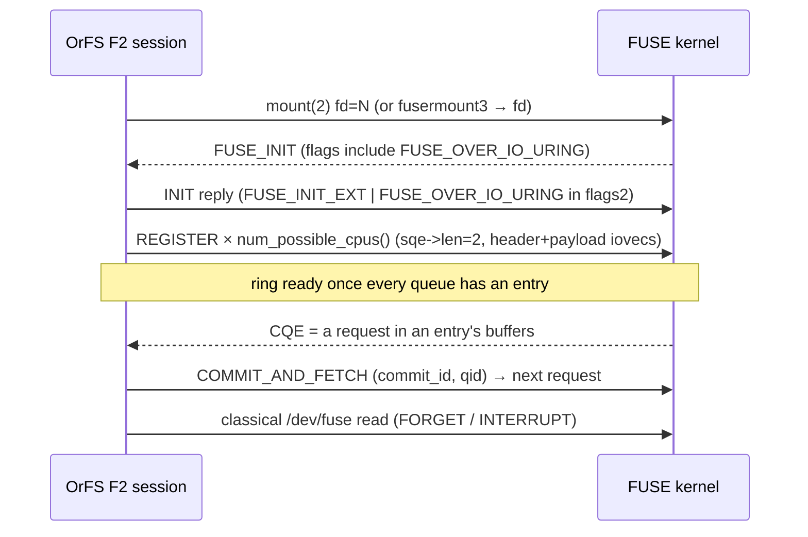

# OrFS FUSE-over-io_uring transport (Phase 15)

**Status:** a **real F2 mount is achieved** on this host. An OrFS volume mounted
with `--transport fuse-uring` serves ordinary POSIX syscalls through a genuine
FUSE-over-`io_uring` ring on kernel `7.2.9-2-cachyos` (FUSE ABI 7.45,
`fuse.enable_uring=Y`). The live `INIT` negotiation, the ring carrying requests,
and byte-for-byte equivalence with F0 are recorded as evidence. When F2 cannot
engage, the mount falls back to F1/F0 with byte-identical contents and the exact
reason.

Sources: `src/fuse_native.rs` (the native session that owns `/dev/fuse`),
`src/fuse_uring.rs` (the UAPI codec + ring command layer, incl. the raw-SQE path),
`src/fuse.rs` (the transport-neutral `OrfsFuse` adaptor + `classify`),
`src/buffers.rs` (the registered-buffer pin discipline), `tests/fuse_uring.rs`.

This document is normative for transport profiles F0/F1/F2 (research §17–§19,
directive §16/§17).

---

## 1. Two `io_uring` domains, three profiles

| Domain | What it accelerates | Where |
|--------|---------------------|-------|
| **A — backing store** | authoritative writes, immutable reads, `fsync` | `src/uring.rs` |
| **B — FUSE transport** | kernel↔userspace request delivery | `src/fuse_native.rs`, `src/fuse_uring.rs` |

Turning on Domain A does **not** turn on Domain B.

| Profile | Request transport | Backing I/O | How OrFS reports it |
|---------|-------------------|-------------|---------------------|
| **F0** | `/dev/fuse` (`fuser`) | synchronous | `transport_used() == F0` |
| **F1** | `/dev/fuse` (`fuser`) | `io_uring` rings W/R | `transport_used() == F1` |
| **F2** | FUSE-over-`io_uring` (native session) | `io_uring` rings W/R | `transport_used() == F2` |

`classify` returns **F2 only** when the negotiation reports a running ring.
Backing `io_uring` alone is F1, never F2.

---

## 2. UAPI on this kernel (FUSE ABI 7.45, baseline interface)

Transcribed from the running kernel's own source (`fs/fuse/dev_uring.c`,
`include/uapi/linux/fuse.h`), not from container headers.

`enum fuse_uring_cmd`:

| Constant | Value |
|----------|------:|
| `FUSE_IO_URING_CMD_INVALID` | 0 |
| `FUSE_IO_URING_CMD_REGISTER` | 1 |
| `FUSE_IO_URING_CMD_COMMIT_AND_FETCH` | 2 |

**`ADD_QUEUE` (3) and `ADD_BUFPOOL` (4) do not exist at ABI 7.45**, and the
buffer-pool `offset` field does not either. This kernel exposes only the baseline
interface; the modern commands are compiled and capability-gated but deliberately
inert here (see §7):

* **Queue creation is implicit.** `fuse_uring_register` creates a queue lazily on
  the first `REGISTER` whose `qid < nr_queues`, where `nr_queues = num_possible_cpus()`
  (`fuse_uring_create_queue`).
* **The ring becomes ready only when *every* queue has an available entry**
  (`is_ring_ready`): the server must register at least one entry per CPU queue.
* A request carries its payload in the registered payload buffer; ABI 7.45 has no
  pool-offset indirection.

`struct fuse_uring_cmd_req` (80-byte SQE command area; 24 bytes used here):

| Offset | Field |
|-------:|-------|
| 0 | `u64 flags` |
| 8 | `u64 commit_id` |
| 16 | `u16 qid` |
| 18 | `u8[6] padding` |

`struct fuse_uring_ent_in_out` (32 bytes at header offset 256): `flags`, `commit_id`,
`payload_sz`, `padding`, `reserved`. **`payload_sz` is at offset 272** and is used
for both the request payload size and, on the reply, the reply-data size.

`struct fuse_uring_req_header` = `char in_out[128]` + `char op_in[128]` +
`fuse_uring_ent_in_out` = 288 bytes. `in_out` holds `fuse_in_header` (request) or
`fuse_out_header` (reply).

In-crate tests pin every size and opcode value and round-trip the codec.

### 2.1 The raw-SQE `sqe->len` path

`FUSE_IO_URING_CMD_REGISTER` requires `sqe->len == FUSE_URING_IOV_SEGS (2)`
(`fuse_uring_get_iovec_from_sqe`). The pinned `io-uring` 0.7.15 crate exposes no
`len` setter, so `src/fuse_uring.rs::entry128_set_len` writes the ABI field
directly into the `#[repr(C)]`, exactly-128-byte `Entry128` (byte offset 24, the
kernel's `struct io_uring_sqe.len`). The unsafe invariant is documented at the
function. Everything else (`COMMIT_AND_FETCH`, cancellation) leaves `len` zero.

---

## 3. The native F2 session (`src/fuse_native.rs`)

`fuser` 0.18 does not expose its `/dev/fuse` fd, so the F2 path owns the whole
session:

1. **Open + mount.** `open("/dev/fuse")` then `mount(2)` with
   `fd=N,rootmode=…,user_id=…,group_id=…,subtype=orfs`. When the process has no
   effective `CAP_SYS_ADMIN` (verified in the kmount container: `CapEff=0`), the
   setuid `fusermount3` helper is used instead; it performs the mount and **sends
   the `/dev/fuse` fd back** over the `_FUSE_COMMFD` Unix socket
   (`libfuse util/fusermount.c`: `send_fd(cfd, fd)`).
2. **`INIT`.** Reads the kernel's `FUSE_INIT` and replies with
   `FUSE_INIT_EXT | FUSE_ASYNC_READ | FUSE_BIG_WRITES` in `flags` and
   `FUSE_OVER_IO_URING` (bit 41 → `flags2` bit 9). The kernel then sets
   `fc->io_uring = 1`.
3. **Ring.** Creates the `IORING_SETUP_SQE128` ring and registers one entry per
   CPU queue. Each entry owns a 4 KiB header buffer and a 256 KiB payload buffer
   at a stable heap address (see §4).
4. **Drive.** The ring's completion for an entry *is* the next request delivered
   into that entry's buffers. The session loop parses the request, dispatches it,
   writes the reply into the same buffers, and re-arms the entry with
   `COMMIT_AND_FETCH`. Phase 26 makes the *servicing topology* a measured choice
   (`--f2-servicing single|pool`, default `single`); see §6.2 for the measurement
   that selected it and §7 for the ABI-7.45 capability boundary.
5. **Classical channel.** `FORGET`/`BATCH_FORGET`/`INTERRUPT` are still delivered
   over `/dev/fuse` (`fuse_io_uring_ops` keeps `send_forget`/`send_interrupt`
   classical); a second reader thread services them.

> **Task ownership matters.** `io_uring` delivers `URING_CMD` completions as
> task-work to the *submitting* task (`io_uring_cmd_complete_in_task`). The ring
> is therefore created and every SQE submitted by the **session thread** that also
> parks waiting for completions. Creating it anywhere else deadlocks (the syscall
> that queued the request sleeps in the kernel and never runs its task-work).

### 3.1 Reuse, not reinvention

The F2 dispatcher borrows the **same** transport-neutral `OrfsFuse` adaptor the
classical transport uses (handle table, lookup accounting, permission checks,
metrics). F2 and F0/F1 cannot diverge in filesystem semantics; only the path the
bytes travel differs.

---

## 4. Registered-buffer lifetimes

A ring entry's header and payload buffers are heap-backed `AlignedBuffer`s: their
address is fixed for the entry's lifetime, and they must remain allocated and
untouched for as long as the kernel keeps the entry registered. This is the same
pin discipline `src/buffers.rs` enforces for backing I/O, specialised by
`BufferPool::register_iovecs` into the 2-element iovec array
`REGISTER` imports. The array itself is boxed so its address is stable across
moves of the owning struct. `EntryState` is `unsafe impl Send` with the documented
invariant that the iovec bases point into allocations it owns.

---

## 5. Negotiation, fallback, and `doctor`

`orfs mount --transport fuse-uring` attempts the native session first. If it
cannot engage for any reason (no `/dev/fuse`, mount denied, kernel does not offer
`FUSE_OVER_IO_URING`, a `REGISTER` rejection, …) the exact reason is reported and
the classical `/dev/fuse` transport is used instead, with byte-identical contents.

`orfs doctor` performs a **live** negotiation when the static preconditions hold:
a throwaway mount + `INIT` + ring registration, then teardown. It reports the real
result (with the `INIT` flags and queue count) rather than a prediction; when the
preconditions provably fail, it reports the exact static reason and mounts nothing.

---

## 6. Measurements (real F0 / F1 / F2, Phase 26)

`tests/fuse_uring.rs::f2_court_f0_f1_f2` drives identical workloads through three
real, simultaneously-mounted filesystems (F0, F1, F2) with `direct_io` on and
attribute/entry TTL `0`, so every read and lookup is a real transport round-trip.
The court is **paired**: each of 15 repetitions runs the same workload under F0,
then F1, then F2, back to back, so machine drift affects every profile alike.
Per-op samples are recorded, so percentiles are meaningful; means carry a
two-sided 95% Student-t interval, and a difference is called *significant* only
when the paired-t interval of (F2−F0) or (F2−F1) per-pair means excludes zero.
Machine-generated results: `evidence/performance/fuse-uring.json` and
`evidence/performance/f2-concurrency.json`.

### 6.1 Two counters: syscall time vs requests that reach the daemon

Every workload reports both what the application waits for (application-level
syscall time) and the *requests that actually reached the daemon*. The latter is
read from the shared daemon-operation counters (identical bookkeeping for
F0/F1/F2) and, for F2, the native ring's own `requests_served` counter. This makes
the claim falsifiable rather than implied: for 16 concurrent readers × 80 ops ×
8 pairs, all three profiles recorded exactly `10240` daemon read requests, and the
F2 ring recorded `10264` (reads plus the `OPEN`/`LOOKUP`/`GETATTR` requests the
ring also carried). No read was answered above the daemon.

### 6.2 Queue servicing: single loop vs worker pool (chosen by measurement)

The kernel registers one entry per CPU queue (`num_queues = num_possible_cpus()`);
the Phase-15 session serviced every queue on one thread. Phase 26 adds a bounded,
workload-aware **worker pool** (`F2Servicing::Pool { fast, bulk }`): a *latency*
lane for metadata and small reads, a *bulk* lane for ≥ 64 KiB reads/writes, run by
dedicated workers so a small metadata op never queues behind a large read. The
session thread alone owns the ring and submits every SQE (the kernel delivers
`URING_CMD` completions as task-work to the submitting task); workers only run the
dispatch and stage the reply into the entry's registered buffers via a documented
`unsafe` handoff (`EntryPtr`) with no extra copy.

Measured on this host (16 queues, 8 CPUs), paired, 8 reps:

| topology | 8-reader ops/s | 16-reader ops/s | read-4K mean µs |
|---|---:|---:|---:|
| **single loop (chosen)** | **100 694** | **104 876** | **13.10** |
| pool (fast=2, bulk=6) | 86 976 | 89 349 | 22.77 |
| pool + CPU affinity | 87 000 | 89 350 | 22.8 |

The pool is **significantly slower** on 16 readers (paired diff −21 651 ops/s,
95% CI [−32 033, −11 268]) and adds a **significant** ~5.2 µs to read-4K latency
(CI [3.19, 7.20]). The reason is structural: F2's concurrency bottleneck at ABI
7.45 is the single-ring `COMMIT_AND_FETCH` round-trip per request, *not* dispatch
work, so moving dispatch off the session thread only adds a handoff. The chosen
default is therefore **`single-loop`**; the pool remains selectable
(`--f2-servicing pool`) and is proven byte-equivalent to F0 by
`f2_pool_servicing_preserves_semantics`.

### 6.3 Single-threaded latency (warm, paired, 15 pairs)

| workload | F0 mean µs | F1 mean µs | F2 mean µs | F2−F0 | F2−F1 |
|---|---:|---:|---:|---|---|
| read 1 B | 5.17 | 5.74 | 5.53 | n.s. | n.s. |
| read 64 B | 5.40 | 5.45 | 5.24 | n.s. | n.s. |
| read 4 KiB | 14.24 | 15.77 | 13.93 | n.s. | n.s. |
| read 64 KiB | 121.9 | 120.2 | 122.1 | n.s. | n.s. |
| lookup (`stat`) | 11.40 | 9.81 | 13.97 | n.s. | **+4.16 (sig)** |
| create+unlink | 237.8 | 293.5 | 268.4 | n.s. | n.s. |
| `fdatasync` | 49 151 | 48 371 | 46 532 | n.s. | n.s. |

("n.s." = not significant at 95%.) The only single-threaded significant finding
is that F2's lookup is ~4.2 µs slower than F1's. Reads and writes are
statistically indistinguishable across F0/F1/F2 — the transport is real, but it is
not faster for single-threaded latency.

### 6.4 Concurrency and the sustained mixed workload

Paired, 8 reps, 4 KiB readers:

| readers | F0 ops/s | F1 ops/s | F2 ops/s | F2 vs F0 |
|---|---:|---:|---:|---|
| 1 | 72 014 | 76 697 | 81 441 | +9 427 (n.s.) |
| 2 | 108 290 | 115 382 | 98 913 | n.s. |
| 4 | 210 739 | 211 741 | 90 942 | **−119 797 (sig)** |
| 8 | 365 936 | 352 129 | 100 703 | **−265 233 (sig)** |
| 16 | 383 490 | 382 577 | 108 094 | **−275 395 (sig)** |

This is the honest headline: **F2 does not scale with reader concurrency on this
ABI** (≈81 k → 108 k ops/s from 1 to 16 readers), while F0/F1 scale to ≈383 k.
Each F2 request costs a `COMMIT_AND_FETCH` SQE plus a kernel round-trip, and the
single ring serialises them; the classical transport answers with a plain write.
The sustained mixed workload (4 threads, reads/lookups/create-unlink) shows no
significant difference (F0 20 323, F1 19 071, F2 19 570 ops/s; all intervals
overlap).

> **No superiority is claimed.** The point of the F2 row is that the ring really
> carries the traffic (equivalence, per-op samples, and the daemon-reaching
> counters prove it), not that it wins a benchmark. Under ABI 7.45 it is roughly
> latency-neutral single-threaded and slower under concurrency.

### 6.5 Cold vs warm

The court records a **cold first-touch** pass per profile immediately after mount
(the read planner's caches are cold) and 15 **warm** paired passes. Host page
cache cannot be dropped without root, and `direct_io` bypasses it for reads anyway;
so "cold" here means the OrFS read planner is uncalibrated, not the host cache.
Both are in `fuse-uring.json`.

Provenance: `evidence/performance/fuse-uring.json` (paired statistics, per-op
percentiles, daemon-reaching counts, per-workload tables, servicing benchmark),
`evidence/performance/f2-concurrency.json` (reader scaling + mixed + servicing),
`evidence/correctness/fuse-uring-f2-engagement.json` (live `INIT` flags, 16
queues, counters), `evidence/correctness/fuse-uring-equivalence.json` (identical
F0/F1/F2 transcript), `evidence/correctness/fuse-uring-ring.json` (ring-layer
submission/cancel/shutdown).

---

## 7. The ABI-7.45 capability boundary and forward compatibility

The kernel here is FUSE ABI 7.45: it supports the **original** FUSE-over-`io_uring`
interface (`REGISTER` + `COMMIT_AND_FETCH`, queues created lazily) but **not**
`FUSE_IO_URING_CMD_ADD_QUEUE` (3), `FUSE_IO_URING_CMD_ADD_BUFPOOL` (4), or the
zero-copy flags — those appeared with the buffer-pool extension. Merely defining
the UAPI constants is not enough; the features must be **capability-negotiated and
proven**, and they are not claimed here.

The forward-compatible commands are wired behind a runtime capability check:

* `FuseUringNegotiation` now records `kernel_offered_bufpool` (from
  `FUSE_HAS_IO_URING_BUFPOOL` at `INIT`), `cap_sys_admin`, and `num_queues`.
* `FuseUringNegotiation::capabilities()` produces the exact `F2Capabilities` set:
  baseline interface, `ADD_QUEUE`/`ADD_BUFPOOL`, and zero-copy — each `true` **only**
  when the kernel offered the extension (`add_queue = engaged && bufpool && offered`;
  `zero_copy = add_queue && CAP_SYS_ADMIN`).
* `plan_queues()` returns `QueuePlan::Modern` **only** when the buffer pool was
  offered; otherwise `QueuePlan::Baseline`. At ABI 7.45 the plan is always
  `Baseline`, so `ADD_QUEUE`/`ADD_BUFPOOL`/zero-copy are **inert** (never reported
  available, never issued). Should a future kernel offer the extension, the modern
  path is taken, and any rejection degrades to the baseline interface rather than
  failing the mount.
* `orfs doctor` reports the exact negotiated set (regardless of JSON or text
  output); on this host it prints the boundary line
  "FUSE ABI 7.45 exposes only the baseline REGISTER + COMMIT_AND_FETCH interface;
  ADD_QUEUE/ADD_BUFPOOL and zero-copy are inert (not offered)".

## 8. Remaining limits (ABI 7.45)

* No `ADD_QUEUE`/`ADD_BUFPOOL` and no buffer-pool `offset`; only the baseline
  register/commit interface (queues created lazily; one entry per CPU queue).
* Zero-copy is not exercised on this kernel; no zero-copy number is claimed.
* A native F2 mount exposes **no** `fuser` `Notifier`, so `OrfsMount::notifier()`
  is `None` (explicit cache invalidation is unavailable on F2).
* `auto_unmount` is not forwarded to `fusermount3`; teardown is driven by the
  session's own unmount path.
* FUSE passthrough (research §28.2) is not implemented.

---

## 9. `unsafe` inventory

| Location | Invariant |
|----------|-----------|
| `fuse_uring.rs::entry128_set_len` | `Entry128` is `#[repr(C)]`, exactly 128 bytes, mirroring `struct io_uring_sqe`; byte 24 is `sqe->len`. Writes only within the owned value, unaligned. |
| `fuse_uring.rs::FuseUringRing::push_cmd` | the SQE references only bytes copied into it and, when `addr` is set, a caller-owned buffer kept alive for the operation's lifetime |
| `fuse_uring.rs::FuseUringRing::cancel` | `AsyncCancel` references no user buffer; the target is `user_data` |
| `fuse_native.rs` mount/`recvmsg`/`poll`/`read` | valid path/data pointers that outlive each syscall; the fd handed over `SCM_RIGHTS` is taken ownership of exactly once |
| `fuse_native.rs::EntryState` `unsafe impl Send` | the iovec bases point into allocations `EntryState` owns and moves with it |
| `fuse_native.rs::EntryPtr` `unsafe impl Send` + `serve_job` | a worker gets exclusive access to `entries[idx]` only while `inflight[idx]` is `true`, and the session neither touches the entry nor submits `COMMIT_AND_FETCH` until the matching `Done` returns; the `mpsc` handoff supplies the happens-before edge |
| `fuse_native.rs::pin_to_cpu` | a fully-owned `[u8; CPU_SETSIZE/8]` bitmask is passed to `sched_setaffinity` for the duration of the call only |

---

## 10. Explicit non-claims

* Zero-copy performance is not claimed, and zero-copy is inert at ABI 7.45.
* `ADD_QUEUE`/`ADD_BUFPOOL` are compiled and cap-checked but not exercisable here.
* FUSE passthrough is not implemented.
* No performance superiority over F0/F1 is claimed. The measured results (§6) show
  F2 is latency-neutral single-threaded and slower under reader concurrency on this
  ABI; that is reported as found.
