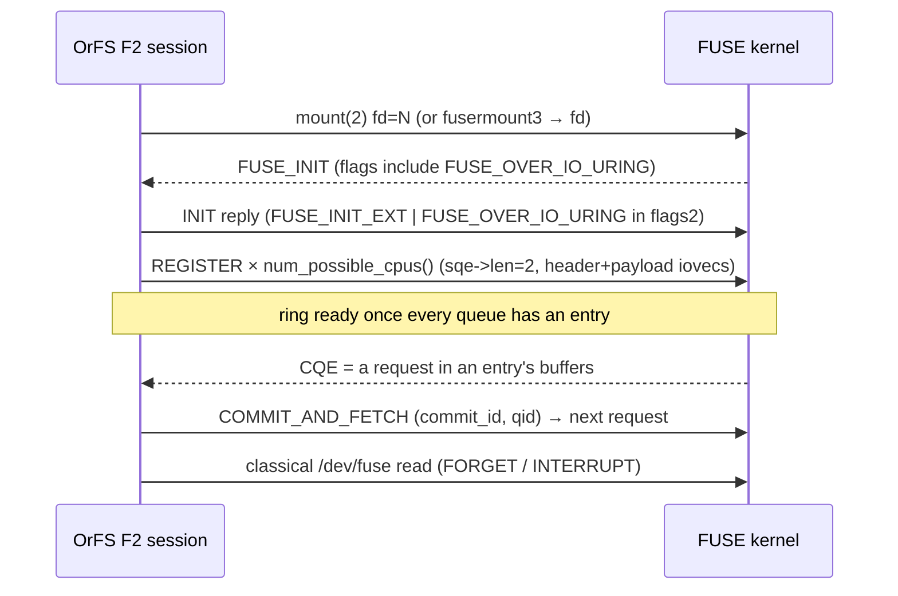

# OrFS FUSE-over-io_uring transport (Phase 15)

**Status:** a **real F2 mount is achieved** on this host. An OrFS volume mounted
with `--transport fuse-uring` serves ordinary POSIX syscalls through a genuine
FUSE-over-`io_uring` ring on kernel `7.2.9-2-cachyos` (FUSE ABI 7.45,
`fuse.enable_uring=Y`). The live `INIT` negotiation, the ring carrying requests,
and byte-for-byte equivalence with F0 are recorded as evidence. When F2 cannot
engage, the mount falls back to F1/F0 with byte-identical contents and the exact
reason.

Sources: `src/fuse_native.rs` (the native session that owns `/dev/fuse`),
`src/fuse_uring.rs` (the UAPI codec + ring command layer, incl. the raw-SQE path),
`src/fuse.rs` (the transport-neutral `OrfsFuse` adaptor + `classify`),
`src/buffers.rs` (the registered-buffer pin discipline), `tests/fuse_uring.rs`.

This document is normative for transport profiles F0/F1/F2 (research §17–§19,
directive §16/§17).

---

## 1. Two `io_uring` domains, three profiles

| Domain | What it accelerates | Where |
|--------|---------------------|-------|
| **A — backing store** | authoritative writes, immutable reads, `fsync` | `src/uring.rs` |
| **B — FUSE transport** | kernel↔userspace request delivery | `src/fuse_native.rs`, `src/fuse_uring.rs` |

Turning on Domain A does **not** turn on Domain B.

| Profile | Request transport | Backing I/O | How OrFS reports it |
|---------|-------------------|-------------|---------------------|
| **F0** | `/dev/fuse` (`fuser`) | synchronous | `transport_used() == F0` |
| **F1** | `/dev/fuse` (`fuser`) | `io_uring` rings W/R | `transport_used() == F1` |
| **F2** | FUSE-over-`io_uring` (native session) | `io_uring` rings W/R | `transport_used() == F2` |

`classify` returns **F2 only** when the negotiation reports a running ring.
Backing `io_uring` alone is F1, never F2.

---

## 2. UAPI on this kernel (FUSE ABI 7.45, baseline interface)

Transcribed from the running kernel's own source (`fs/fuse/dev_uring.c`,
`include/uapi/linux/fuse.h`), not from container headers.

`enum fuse_uring_cmd`:

| Constant | Value |
|----------|------:|
| `FUSE_IO_URING_CMD_INVALID` | 0 |
| `FUSE_IO_URING_CMD_REGISTER` | 1 |
| `FUSE_IO_URING_CMD_COMMIT_AND_FETCH` | 2 |

**`ADD_QUEUE` (3) and `ADD_BUFPOOL` (4) do not exist at ABI 7.45**, and the
buffer-pool `offset` field does not either. This kernel exposes only the baseline
interface:

* **Queue creation is implicit.** `fuse_uring_register` creates a queue lazily on
  the first `REGISTER` whose `qid < nr_queues`, where `nr_queues = num_possible_cpus()`
  (`fuse_uring_create_queue`).
* **The ring becomes ready only when *every* queue has an available entry**
  (`is_ring_ready`): the server must register at least one entry per CPU queue.
* A request carries its payload in the registered payload buffer; ABI 7.45 has no
  pool-offset indirection.

`struct fuse_uring_cmd_req` (80-byte SQE command area; 24 bytes used here):

| Offset | Field |
|-------:|-------|
| 0 | `u64 flags` |
| 8 | `u64 commit_id` |
| 16 | `u16 qid` |
| 18 | `u8[6] padding` |

`struct fuse_uring_ent_in_out` (32 bytes at header offset 256): `flags`, `commit_id`,
`payload_sz`, `padding`, `reserved`. **`payload_sz` is at offset 272** and is used
for both the request payload size and, on the reply, the reply-data size.

`struct fuse_uring_req_header` = `char in_out[128]` + `char op_in[128]` +
`fuse_uring_ent_in_out` = 288 bytes. `in_out` holds `fuse_in_header` (request) or
`fuse_out_header` (reply).

In-crate tests pin every size and opcode value and round-trip the codec.

### 2.1 The raw-SQE `sqe->len` path

`FUSE_IO_URING_CMD_REGISTER` requires `sqe->len == FUSE_URING_IOV_SEGS (2)`
(`fuse_uring_get_iovec_from_sqe`). The pinned `io-uring` 0.7.15 crate exposes no
`len` setter, so `src/fuse_uring.rs::entry128_set_len` writes the ABI field
directly into the `#[repr(C)]`, exactly-128-byte `Entry128` (byte offset 24, the
kernel's `struct io_uring_sqe.len`). The unsafe invariant is documented at the
function. Everything else (`COMMIT_AND_FETCH`, cancellation) leaves `len` zero.

---

## 3. The native F2 session (`src/fuse_native.rs`)

`fuser` 0.18 does not expose its `/dev/fuse` fd, so the F2 path owns the whole
session:

1. **Open + mount.** `open("/dev/fuse")` then `mount(2)` with
   `fd=N,rootmode=…,user_id=…,group_id=…,subtype=orfs`. When the process has no
   effective `CAP_SYS_ADMIN` (verified in the kmount container: `CapEff=0`), the
   setuid `fusermount3` helper is used instead; it performs the mount and **sends
   the `/dev/fuse` fd back** over the `_FUSE_COMMFD` Unix socket
   (`libfuse util/fusermount.c`: `send_fd(cfd, fd)`).
2. **`INIT`.** Reads the kernel's `FUSE_INIT` and replies with
   `FUSE_INIT_EXT | FUSE_ASYNC_READ | FUSE_BIG_WRITES` in `flags` and
   `FUSE_OVER_IO_URING` (bit 41 → `flags2` bit 9). The kernel then sets
   `fc->io_uring = 1`.
3. **Ring.** Creates the `IORING_SETUP_SQE128` ring and registers one entry per
   CPU queue. Each entry owns a 4 KiB header buffer and a 256 KiB payload buffer
   at a stable heap address (see §4).
4. **Drive.** The ring's completion for an entry *is* the next request delivered
   into that entry's buffers. The loop parses the request, dispatches it, writes
   the reply into the same buffers, and re-arms the entry with `COMMIT_AND_FETCH`.
5. **Classical channel.** `FORGET`/`BATCH_FORGET`/`INTERRUPT` are still delivered
   over `/dev/fuse` (`fuse_io_uring_ops` keeps `send_forget`/`send_interrupt`
   classical); a second reader thread services them.

> **Task ownership matters.** `io_uring` delivers `URING_CMD` completions as
> task-work to the *submitting* task (`io_uring_cmd_complete_in_task`). The ring
> is therefore created and every SQE submitted by the **session thread** that also
> parks waiting for completions. Creating it anywhere else deadlocks (the syscall
> that queued the request sleeps in the kernel and never runs its task-work).

### 3.1 Reuse, not reinvention

The F2 dispatcher borrows the **same** transport-neutral `OrfsFuse` adaptor the
classical transport uses (handle table, lookup accounting, permission checks,
metrics). F2 and F0/F1 cannot diverge in filesystem semantics; only the path the
bytes travel differs.

---

## 4. Registered-buffer lifetimes

A ring entry's header and payload buffers are heap-backed `AlignedBuffer`s: their
address is fixed for the entry's lifetime, and they must remain allocated and
untouched for as long as the kernel keeps the entry registered. This is the same
pin discipline `src/buffers.rs` enforces for backing I/O, specialised by
`BufferPool::register_iovecs` into the 2-element iovec array
`REGISTER` imports. The array itself is boxed so its address is stable across
moves of the owning struct. `EntryState` is `unsafe impl Send` with the documented
invariant that the iovec bases point into allocations it owns.

---

## 5. Negotiation, fallback, and `doctor`

`orfs mount --transport fuse-uring` attempts the native session first. If it
cannot engage for any reason (no `/dev/fuse`, mount denied, kernel does not offer
`FUSE_OVER_IO_URING`, a `REGISTER` rejection, …) the exact reason is reported and
the classical `/dev/fuse` transport is used instead, with byte-identical contents.

`orfs doctor` performs a **live** negotiation when the static preconditions hold:
a throwaway mount + `INIT` + ring registration, then teardown. It reports the real
result (with the `INIT` flags and queue count) rather than a prediction; when the
preconditions provably fail, it reports the exact static reason and mounts nothing.

---

## 6. Measurements (real F0 / F1 / F2)

`tests/fuse_uring.rs::f2_performance_f0_f1_f2` drives identical POSIX workloads
through real mounts with `direct_io` on and attribute/entry TTL `0`, so every read
and lookup is a real transport round-trip. Machine-generated results are in
`evidence/performance/fuse-uring.json`; environment: kernel `7.2.9-2-cachyos`,
ABI 7.45, container image id `sha256:a41df86d…`, mount options
`fsname=orfs,subtype=orfs,max_read=131072,rw`.

| workload | F0 | F1 | F2 |
|----------|----|----|----|
| sequential read (MiB/s) | ~4000 | ~3600 | ~4800 |
| random 4K read (µs/op) | ~7.4 | ~9.0 | ~9.0 |
| random 1-byte read (µs/op) | ~7.1 | ~8.3 | ~8.8 |
| metadata lookup (µs/op) | ~8.4 | ~8.1 | ~9.5 |
| create+unlink (µs/op) | ~6560 | ~6630 | ~6620 |
| fsync (µs/op) | ~8860 | ~8870 | ~9910 |

These are single-run warm-cache observations on one host/container, not a portable
benchmark, and no performance superiority is claimed. The point of the F2 row is
that the ring really carries the traffic (equivalence and the counters prove it),
not that it is faster.

Provenance: `evidence/correctness/fuse-uring-f2-engagement.json` (live `INIT`
flags, 16 queues, `requests_served`/`completions`/`register_failures` counters),
`evidence/correctness/fuse-uring-equivalence.json` (identical F0/F1/F2 transcript),
`evidence/correctness/fuse-uring-ring.json` (ring-layer submission/cancel/shutdown).

---

## 7. Remaining limits (ABI 7.45)

* No `ADD_QUEUE`/`ADD_BUFPOOL` and no buffer-pool `offset`; only the baseline
  register/commit interface (queues created lazily; one entry per CPU queue).
* Zero-copy is not exercised on this kernel; no zero-copy number is claimed.
* A native F2 mount exposes **no** `fuser` `Notifier`, so `OrfsMount::notifier()`
  is `None` (explicit cache invalidation is unavailable on F2).
* `auto_unmount` is not forwarded to `fusermount3`; teardown is driven by the
  session's own unmount path.
* FUSE passthrough (research §28.2) is not implemented.

---

## 8. `unsafe` inventory

| Location | Invariant |
|----------|-----------|
| `fuse_uring.rs::entry128_set_len` | `Entry128` is `#[repr(C)]`, exactly 128 bytes, mirroring `struct io_uring_sqe`; byte 24 is `sqe->len`. Writes only within the owned value, unaligned. |
| `fuse_uring.rs::FuseUringRing::push_cmd` | the SQE references only bytes copied into it and, when `addr` is set, a caller-owned buffer kept alive for the operation's lifetime |
| `fuse_uring.rs::FuseUringRing::cancel` | `AsyncCancel` references no user buffer; the target is `user_data` |
| `fuse_native.rs` mount/`recvmsg`/`poll`/`read` | valid path/data pointers that outlive each syscall; the fd handed over `SCM_RIGHTS` is taken ownership of exactly once |
| `fuse_native.rs::EntryState` `unsafe impl Send` | the iovec bases point into allocations `EntryState` owns and moves with it |

---

## 9. Explicit non-claims

* Zero-copy performance is not claimed.
* FUSE passthrough is not implemented.
* No performance superiority over F0/F1 is claimed; the F2 numbers exist to prove
  the transport is real, not to win a benchmark.
