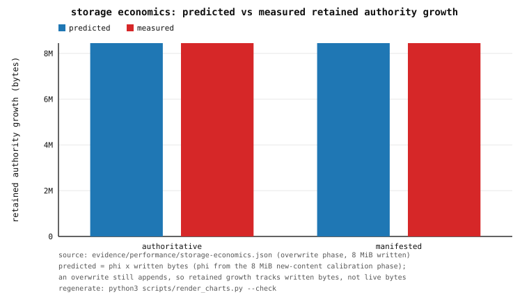
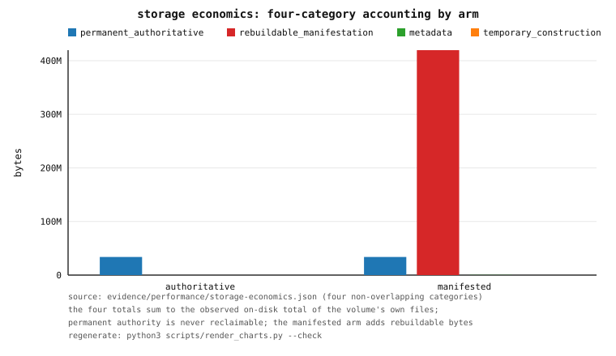

# OrFS — Storage Economics and the Retained-Growth Forecast (Phase 75)

OrFS is **non-withdrawal**: committed authoritative history is never overwritten,
truncated, reused, or garbage-collected (`docs/CAPACITY.md`, research §31). The
consequence is that the physical footprint grows monotonically — so the storage
budget must be **predictable and budgetable**, never reclaimed. This document
defines the accounting that attributes that growth and the forecast model that
projects it, plus the operator procedure for reading both.

`orfs doctor --economics --backing <dir>` produces the report; the court
`tests/storage_economics.rs` validates the forecast against a measured workload
and writes `evidence/performance/storage-economics.json`.

> **Scope.** This phase is the *storage-economics* half of the operational control
> plane. **Tier relocation is the follow-on phase and is not implemented here.**
> The forward reference at the end states the constraints that phase must respect.

## 1. Why this phase exists

The Phase-68 capacity guard answers "is there room for the next commit?" and the
Phase-69 endurance court measures the *space amplification*. Neither answers the
operator's real question: **"given how I write, when does this volume fill, and
what is filling it?"** This phase answers both, and — the crux — makes the answer
**falsifiable**, not asserted.

Two design principles from the field are adopted deliberately:

* **Kafka tiered storage (KIP-405)** keeps metadata **strongly consistent and
  separate** from the data tier, makes copy/delete **idempotent**, uses explicit
  state transitions, and **never removes the local copy before the remote copy is
  verified and recorded**. The separated accounting here is the same discipline:
  authority, derived structures, and metadata are measured as distinct tiers.
* **RocksDB** treats **write / read / space amplification** as first-class,
  measurable objectives with a **hard space limit**. The discipline is to *measure*
  the amplification, never assume it. Here the retained-growth amplification is
  measured in a calibration phase and used to *predict* the next phase.

## 2. The four accounting categories

Every **regular file** beneath a volume root is classified into exactly one of
four non-overlapping categories (`src/capacity.rs`, `StorageCategory`):

| Category | What it holds | Reclaimable? |
|---|---|---|
| **Permanent authoritative history** | Every byte under `or.log/`: the committed segment files, the durable commit watermark, and any retained / quarantined tail. | **Never.** Non-withdrawal is the point. |
| **Rebuildable manifestations** | EKBLOOM bodies (`ekbloom/`), the positional trigram index (`trigram/`), the global search directory (`directory/`), direct-page atlases (`atlas/`), the suffix/image accelerators, and kernel-passthrough images (`.or_passthrough/`). | Yes — derived; dropping them costs no authority and they rebuild on demand. |
| **Metadata** | The append-only catalogues, generation manifests (`manifests/`), index snapshots / checkpoints, committed-root accelerators (`index/`), and `volume.meta`. | Yes — derived / rebuildable. |
| **Temporary construction space** | In-progress build bytes: scratch / torn `*.tmp` files staged before an atomic rename. | Yes — bounded and cancelable; a crash here can never lose authority. |

The classification is by path (a single recursive walk assigns each file exactly
once), so the categories are **disjoint by construction**. The report then proves
them exhaustive: it compares their sum against an *independently measured* on-disk
total (`manifestation::dir_bytes`) and records
`categories_disjoint_and_complete = (total == observed_volume_bytes)`.

### 2.1 The report

`orfs doctor --economics --backing <dir>` prints the table; `--json` emits schema
`orfs.storage.economics.v1`. Each category carries its byte total, its file count,
and `bytes_per_file`; the report also carries the committed **transaction count**,
the sampled **bytes per transaction**, and the **overwrite ratio** `ρ = overwritten
bytes / new logical bytes` (which the append-only log cannot know from its own
state, so it is operator- or workload-supplied; `null` when unmeasured).

**Worked example** — the committed receipt
`evidence/performance/storage-economics.json` (manifested arm; 8 MiB written as
new content, 8 MiB written as overwrites):

| Category | Bytes | Files | Bytes/file |
|---|---:|---:|---:|
| permanent_authoritative | 33 798 810 | 172 | 196 504 |
| rebuildable_manifestation | 419 546 560 | 264 | 1 589 191 |
| metadata | 330 108 | 529 | 624 |
| temporary_construction | 0 | 0 | — |
| **total** | **453 675 478** | | |
| observed on-disk total | 453 675 478 | | |

The four categories sum exactly to the observed total. The authoritative arm over
the *same* history has `rebuildable_manifestation = 0`; enabling the concealed
plane adds 419 546 560 bytes there **without changing one authoritative byte**
(the two arms' committed roots are asserted equal by the court).

## 3. The forecast model

### 3.1 Inputs

The model takes explicit rates so an operator can plug in their own
(`--write-rate`, `--overwrite-ratio`, `--authority-amplification`,
`--manifested-rate`, `--metadata-rate`, `--transactions-rate`; `ForecastInputs`):

| Input | Meaning |
|---|---|
| `W` — written bytes per unit | The **sum of application write lengths** per time unit (new bytes *plus* overwrites). |
| `ρ` — overwrite ratio | `overwritten bytes / new logical bytes` (`≥ 0`; pure append is `0`). |
| `φ` — authority amplification | Authoritative bytes appended per logical byte written (record framing + transaction brackets); `1.0` is the pure-payload lower bound. |
| `m` — manifested bytes per unit | The manifested-tier growth rate. |
| `c` — metadata bytes per unit | The metadata-tier growth rate. |
| `T` — transactions per unit | Committed transactions per time unit. |

### 3.2 Formulas

```
new logical bytes / unit     = W / (1 + ρ)
rewritten bytes / unit       = W - new        (each rewrite still appends)
retained authority growth    = φ · W          ← independent of ρ  (the crux)
total physical growth / unit = φ·W + m + c
headroom                     = free - reserve          (saturating)
time to full                 = headroom / (φ·W + m + c)
bytes per transaction        = φ·W / T
transactions to full         = headroom / (bytes per transaction)
verdict                      = classify(free, reserve, bytes per transaction)
```

### 3.3 The assumption that matters

**An overwrite still appends.** OrFS never rewrites a logical range in place; it
appends a new `DATA` record that supersedes the old one, and the old record
remains in authoritative history forever. Therefore retained growth tracks
**written** bytes, not **live** bytes — exactly the space amplification the
endurance court measured (Phase 69; `docs/PERFORMANCE.md` §30). A model that
predicted growth from live bytes would predict ~0 for a pure-overwrite workload
and be **wrong by 100 %**. The other stated assumptions are returned with every
forecast (`StorageForecast::assumptions`): `φ ≥ 1`; `m`/`c` are supplied rates;
time-to-full is `headroom / growth`, and the reserve is never consumed; the
forecast is a linear extrapolation of the supplied/observed rates and is
validated by `tests/storage_economics.rs`.

### 3.4 Worked numbers (from the receipt)

Calibration phase (8 MiB new content, 128 transactions):

* `W = 8 388 608` B, `retained growth = 8 449 024` B, so `φ = 1.007202`, and
  `bytes per transaction = 66 008`.
* The ~0.72 % framing overhead is the 76-byte per-record header+footer plus the
  transaction brackets, amortised over 64 KiB record payloads.

Prediction and validation (8 MiB overwrites, 128 transactions):

* `predicted = φ · W = 1.007202 × 8 388 608 = 8 449 024` B.
* `measured = 8 449 024` B → **relative error 0.00 ≤ tolerance 0.05**.
* `live logical growth = 0` (content-neutral), so the **naive live-bytes model is
  wrong by 100 %** — it is falsified, and the written-bytes model is confirmed.

Forecast (unit = one 64 KiB transaction, `ρ = 1`):

* `retained authority / unit = 66 008` B, `new live logical / unit = 32 768` B.
* `units to full = 832 297.9`, `transactions to full = 832 297` (against the live
  free space, reserve `0`), verdict **`ok`**.



*Figure 75.1 — the falsifiable claim. Predicted (φ·W, φ from the calibration
phase) and measured retained-authority growth for the overwrite phase, in both
arms. Source: `evidence/performance/storage-economics.json`; regenerate with
`python3 scripts/render_charts.py --check`.*



*Figure 75.2 — the four-category accounting. Permanent authority is identical in
both arms (non-withdrawal); the manifested arm adds rebuildable bytes and a small
metadata tier. Source: `evidence/performance/storage-economics.json`.*

## 4. The operator procedure

1. **Account.** Run `orfs doctor --economics --backing <dir>`. Read the four
   totals and confirm `categories disjoint & complete: yes`. If not, the volume
   tree contains something the classifier did not recognise (report it; the
   classifier must be extended, never the proof weakened).
2. **Budget the tiers.** Permanent authoritative history is the only
   **non-reclaimable** tier. The rebuildable tier is a *choice*: if space is
   scarce, dropping manifested bodies / trigram indexes / atlases frees it and
   only costs read latency (authority is retained). Metadata is small but grows
   with the generation count.
3. **Feed the rates.** Supply the measured `--write-rate` and `--overwrite-ratio`
   (the append-only log cannot infer the overwrite ratio). Add `--manifested-rate`
   / `--metadata-rate` if the manifested tier is growing. `--authority-amplification`
   defaults to the sampled framing; the court measures it as ~1.007 for 64 KiB
   records.
4. **Read the verdict.**
   * `ok` — comfortable headroom above the reserve.
   * `warn` — the headroom is thinner than the reserve itself (or than one
     projected transaction): plan to grow or relocate the backing store.
   * `exhausted` — no headroom: commits will be refused (`ENOSPC`), then the
     volume transitions read-only (`EROFS`). See `docs/CAPACITY.md` §12–§13.
5. **Watch the trend.** `transactions to full` falls as history accumulates; the
   forecast degrades **ok → warn → exhausted** as the reserve is approached
   (asserted by the court at reserves `0`, `¾·free`, and `free + 1`).

## 5. Forward reference — tier relocation (the next phase)

Tiering is **not** implemented here, and when it lands it must obey the KIP-405
principles this phase was designed around:

* **Identity is preserved.** A relocated segment keeps its identity (committed
  root / segment id). Relocation moves a *copy*; it never renumbers, rewrites, or
  withdraws authoritative history.
* **Verify before forgetting.** The local copy is **never** removed before the
  remote copy is verified and its location recorded — an explicit, durable state
  transition, not an inferred one.
* **Idempotent copy and delete.** Copy and delete are individually re-runnable
  after a crash, so a partial relocation converges to exactly one authoritative
  home.
* **Metadata stays consistent and separate.** The relocation catalogue is
  strongly consistent metadata, distinct from the data tier — the same separation
  this document's four categories already make observable.

The four-category accounting is the budget those transitions will spend against:
relocation moves bytes **between** the permanent-authoritative and
rebuildable/metadata tiers, and the forecast continues to bound the
non-withdrawn footprint.

## 6. Evidence and reproduction

* Receipt: `evidence/performance/storage-economics.json` (schema
  `orfs.performance.storage-economics.v1`).
* Court: `tests/storage_economics.rs` (`storage_economics_smoke` is always-on;
  `storage_economics_sweep` is opt-in behind `ORFS_STORAGE_ECONOMICS=1`).
* Regenerate: `sh scripts/container-storage-economics.sh`.
* Charts: `python3 scripts/render_charts.py --check`.
* The full mapping (doc claim → receipt → command) is in `docs/REPRODUCE.md`.
