# OrFS — Immutable Tier Relocation (Phase 76)

OrFS is **non-withdrawal**: committed authoritative history is never overwritten,
truncated, reused, or garbage-collected (`docs/CAPACITY.md`, `docs/LOG-INVARIANTS.md`
I1). That law is about *authority*, not about *where the bytes physically live*.
This document specifies **tier relocation**: moving **sealed** (immutable)
authoritative segments from the local backing store to a cheaper *cold tier*
without changing a single authoritative byte, a committed root, the commit
watermark, or the read path's semantics.

The **active head segment is never relocatable**. Relocation moves a *copy*; it
never renumbers, rewrites, or withdraws.

> **Scope.** This is the follow-on to `docs/STORAGE-ECONOMICS.md` §5. That phase
> made retained growth *observable and budgetable*; this phase lets the operator
> spend a cheaper tier for the *cold* part of retained history while the local
> footprint shrinks — the very budget the four-category accounting measures.

## 1. Why this exists (and the two disciplines adopted)

The local backing store fills monotonically (retained growth `φ·W`, §the
storage-economics forecast). Sealed segments are immutable and cold: once a
segment is no longer the head, its bytes never change again. Relocating them to a
cheaper tier is exactly the storage-economics *choice* — but it must never cost
authority.

Two field disciplines are adopted deliberately (and cited in the code):

* **Apache Kafka tiered storage (KIP-405).** Metadata is kept **strongly
  consistent and separate** from the data tier; copy and delete are **idempotent**;
  the transitions are **explicit and durable**
  (`COPY_SEGMENT_STARTED → COPY_SEGMENT_FINISHED → DELETE_SEGMENT_STARTED →
  DELETE_SEGMENT_FINISHED`); and the local copy is **never removed before the
  remote copy is verified and recorded**.
* **RocksDB.** Amplification and space limits are first-class *measured*
  objectives. Here we **measure the bytes that move** and prove identity, rather
  than assume it (`tests/tier_relocation.rs`).

## 2. On-disk layout

Relocation adds exactly two things, both derived metadata — never authoritative
bytes in a new form:

| Path | Role | Storage category |
|---|---|---|
| `<volume>/.or_bloom/tiering/relocations.cat` | The **relocation catalogue**: an append-only, immutable record of durable state transitions. | **Metadata** (asserted by a unit test) |
| `<tier_root>/orfs-tier/<uuid>/<segment id>/<digest>.seg` | The **content-addressed tier object** for a released segment. | The cold tier (outside the volume) |

The catalogue lives under `.or_bloom/` so that
`src/capacity.rs::classify_storage` classifies it as **Metadata** — strongly
consistent, separate from the data tier. A unit test
(`tiering::tests::catalogue_lives_in_the_metadata_category`) asserts the
classification, and the four-category accounting therefore attributes the
catalogue to the metadata tier automatically.

The tier object path is content-addressed by **(volume uuid, segment id,
digest)**: the digest is part of the *name*, so a re-copy after a crash cannot
create a second object for the same bytes.

## 3. The state machine

Each segment has one durable state per volume, folded from the append-only
catalogue (the latest record per segment id wins):

```mermaid
stateDiagram-v2
    [*] --> Local
    Local --> Copying: record durable intent (fsync)
    Copying --> Copied: tier copy written, fsynced,\nread back + digest-verified; record Copied (fsync)
    Copied --> Released: record Released (fsync),\nthen delete the local copy (idempotent)
    Released --> Recalled: operator recall:\ntier copy restored + verified locally,\nthen record Recalled (fsync)
    Recalled --> Copying: relocate again
    Released --> Released: relocate again (convergent no-op)
```



Each **transition is fsynced before the next (destructive) step**. In order:

1. `Copying{intent}` — the digest, length, and tier root are recorded durably
   *before* any tier write. The local copy is still the authoritative home.
2. `Copied{verified}` — recorded only after the tier copy is written, fsynced,
   **read back, and digest-verified**. The local copy is still present.
3. `Released` — recorded **durably**, and only then is the local copy deleted
   (idempotently). The tier copy is now the authoritative home.
4. `Recalled` — the operator path back to `Local`: the tier copy is restored to
   the local store, verified, and the segment is authoritative locally again. The
   tier copy is retained (a redundant, verified copy) — recall never destroys it.

The digest is **BLAKE3** over the segment file's exact bytes. Relocation copies
the whole physical file, so a segment with a retained (abandoned) tail is
preserved byte-for-byte too.

## 4. Integrity contract

Relocation guarantees, and the court asserts each:

* **Never changes a byte.** The tier copy is the local file's exact bytes; after
  relocation every **committed root returns byte-identical content**, the
  committed end offset and the committed digest are unchanged, and a deep verify
  passes both before and after. (Receipt: `boundaries_checked = 41`, all
  byte-identical.)
* **Never renumbers or reorders.** A segment keeps its id (its first logical byte
  offset) and its place in the canonical stream. The log reads the relocated bytes
  at the same logical offsets through a `SegmentSource`.
* **Never withdraws.** The committed root is unchanged; the total authoritative
  byte count (local + tier) is unchanged; the local footprint drops by exactly the
  relocated bytes.
* **Verify before forget.** The local copy is deleted only after the tier copy is
  written, fsynced, read back, and digest-verified — and only after `Released` is
  durable. A fault between the copy and its verification leaves the local copy in
  place.

## 5. Idempotency and convergence

* **Idempotent copy.** The tier target is content-addressed; a re-run either finds
  the object already present (and re-verifies it) or writes the same path. Across
  the receipt's crash matrix, `remote_objects = 1` for every row — never two.
* **Idempotent delete.** Removing an already-removed local copy is a success.
* **Convergence.** A re-run of `relocate` after a crash at any transition
  converges to exactly one authoritative home with the digest intact. The court
  arms a fault **after each transition** and then re-opens and re-runs.

The **crash matrix** covers six transitions — `tier_after_intent`,
`tier_after_remote_copy`, `tier_after_verified`, `tier_after_released`,
`tier_after_local_delete`, and `tier_after_recall` — and every row converges
(`rows_count = 6`, `all_converged = true`).

> **Why a torn `Released` record cannot shorten history.** Because `Released` is
> fsynced *before* the local delete, a torn (non-durable) `Released` record can
> only exist while the local copy is still present — so a reader that ignores the
> torn tail still sees a complete, contiguous history.

## 6. Failure model

| Failure | Behaviour |
|---|---|
| **Process crash** at any transition | The transitions are durable and idempotent; a re-run of `relocate` converges to exactly one authoritative home. No lost or duplicated authority, digest intact. |
| **Tier unavailable** (the tier root is offline/unmounted) | A read that needs a released segment returns the typed [`OrfsError::TierUnavailable`] (`src/error.rs`); the volume open is **refused**, never silently shortened. `orfs tier verify` reports the offline segments explicitly (`unavailable_segments`). Authority is intact: restoring the tier restores the reads. |
| **Tier corruption** (digest mismatch or a missing remote copy) | The typed [`OrfsError::TierCorrupt`] is returned; a read is refused rather than serving wrong or truncated data. |
| **Catalogue corruption** (a flipped byte) | The catalogue refuses to load (`Corrupt`) — fail closed. |
| **Catalogue truncation** (a lost trailing record) | The surviving state (e.g. `Copied`) disagrees with the missing local copy, so the resolver fails closed rather than shortening history. |
| **Catalogue loss** (the file is removed) | The surviving local segment ids are non-contiguous, so the log scan refuses the volume rather than recovering a shorter history. |

The governing rule is **fail closed**: a fault in the relocation metadata can
never fabricate authority, and it can never silently destroy or shorten it.

## 7. Log-layer integration

The log layer is agnostic to *where* a segment physically lives. `src/segment.rs`
gains a [`SegmentSource`]:

```rust
pub trait SegmentSource: Send + Sync {
    fn resolve_path(&self, id: u64) -> Result<PathBuf>;
    fn discover(&self) -> Result<Vec<u64>>;
}
```

* `LocalSegments` is the default (segments under the log directory, byte-for-byte
  the pre-tiering behaviour).
* `TieredSegments` (`src/tiering.rs`) resolves a segment's path: the **local**
  `or.log/<id>.seg` if present, else the **tier** copy when the catalogue says
  `Released`, else a **typed error**.

`Log` (and its `RecordReader`/`SegmentCache`) resolve every segment through the
source, so `scan`, `open`, `recover`, `replay`, `verify`, snapshots, and the read
path are unchanged. `Volume::open` constructs a tier-aware source from the volume
root, making relocation transparent to every caller — a volume with relocated
segments opens, scans, recovers, and verifies **identically** to the un-relocated
volume. The existing call sites are preserved via default wrappers
(`scan_log(dir)`, `Log::open`, `RecordReader::new`, …).

The **watermark / commit invariants still hold**: a volume whose relocated
segments are offline is detected (the released segment cannot be resolved ⇒ the
live bytes are short of the committed prefix) and the open is **refused** — never
silently shortened (`src/watermark.rs`; `docs/RECOVERY.md` §4).

## 8. Operator procedure

The operator surface is the `orfs tier` command group (global `--json`):

```sh
orfs tier relocate --backing <dir> --tier-root <dir> [--segment <id> | --all]
orfs tier list     --backing <dir>
orfs tier verify   --backing <dir>
orfs tier recall   --backing <dir> [--segment <id>]
```

1. **Provision the cold tier.** A directory on a cheaper device (or an
   object-store mount). `--tier-root` must exist; `relocate` canonicalises it and
   records it in the catalogue.
2. **Relocate.** `--segment <id>` relocates one sealed segment; without it (or
   with `--all`) every sealed segment is relocated. The active head is refused.
   Relocation is idempotent, so re-running after an interruption is safe.
3. **Inspect.** `orfs tier list --backing <dir>` reports each segment's state,
   digest, home, and the **local authoritative footprint before/after** —
   `local_authoritative_bytes` drops while `total_authoritative_bytes`
   (local + tier) is unchanged.
4. **Verify.** `orfs tier verify --backing <dir>` re-verifies every relocated
   segment's digest and reports mismatches and offline segments explicitly.
5. **Recall** (if the cold tier must be retired): `orfs tier recall` restores a
   released segment to the local store, verified.

## 9. What relocation does **not** do

* It never changes a byte, a record, a framing length, or a checksum of
  authoritative history.
* It never renumbers a segment or changes its logical position.
* It never withdraws authority: the committed root, the watermark, and the total
  authoritative byte count are unchanged.
* It never relocates the **active head** segment.
* It never *reclaims* space: bytes move to the tier, they are not deleted. The
  local footprint shrinks; the total retained authority does not.
* It never silently repairs a fault: a crash, an offline tier, or a corrupt
  catalogue is reported (typed) or the open is refused.

## 10. Measured results

From `evidence/performance/tier-relocation.json` (schema
`orfs.performance.tier-relocation.v1`; 8 objects × 4 × 32 KiB, 128 KiB segments):

* **10 sealed segments** of **11** were relocated; **1 002 542 bytes** moved.
  The **active head** stayed local.
* **Digest matches 10, mismatches 0**; read-after-relocate byte equivalence is
  **true**; **41** committed boundaries were all byte-identical.
* The committed root (1 068 918) and its digest were **unchanged**; the
  **local authoritative footprint** dropped from 1 068 954 B to 66 412 B (by
  exactly the relocated bytes), while **total authority stayed 1 068 918** B.
* The **crash matrix** has **6** rows, all converged with exactly one home.
* **Tier unavailable**: reads returned the typed error; **10** offline segments
  were reported explicitly; restoring the tier restored the reads.

## 11. Evidence and reproduction

* Receipt: `evidence/performance/tier-relocation.json` (schema
  `orfs.performance.tier-relocation.v1`).
* Court: `tests/tier_relocation.rs` (`tier_relocation_smoke` is always-on;
  `tier_relocation_sweep` is opt-in behind `ORFS_TIER_RELOCATION=1`).
* Regenerate: `sh scripts/container-tier-relocation.sh`.
* The full mapping (doc claim → receipt → command) is in `docs/REPRODUCE.md`.

[`SegmentSource`]: https://docs.rs/orfs/latest/orfs/segment/trait.SegmentSource.html
[`OrfsError::TierUnavailable`]: ../src/error.rs
[`OrfsError::TierCorrupt`]: ../src/error.rs
